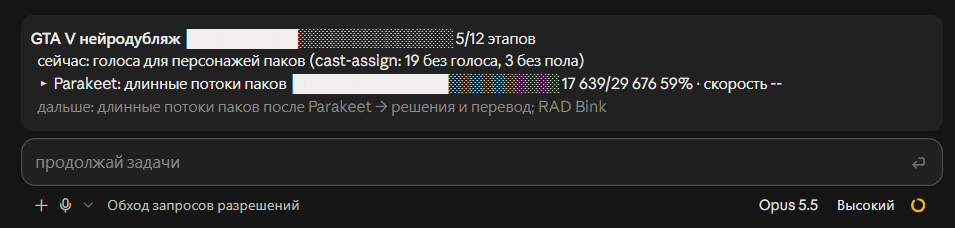
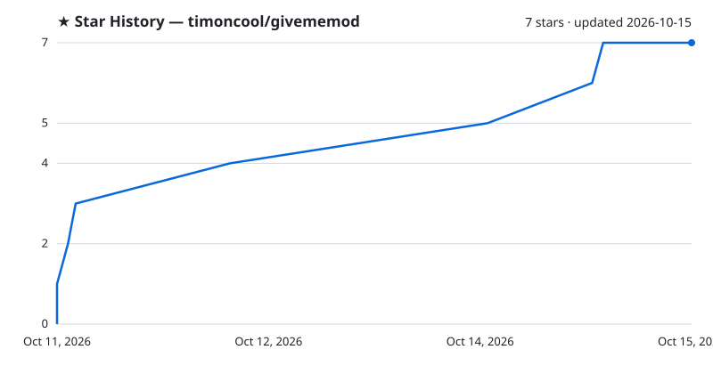

<div align="center">

# givememod

**输入 /givememod，Claude Code 就为你手头的任务做一个 mod。**

[](LICENSE)
[](https://github.com/timoncool/givememod/stargazers)
[](https://github.com/timoncool/givememod/commits)
[](https://timoncool.github.io/givememod/zh.html)

**[English](README.md)** · **[Русский](README_RU.md)** · **[中文](README_ZH.md)**


</div>

givememod 是一个 Claude Code skill，按需制作 Claude Code mod。它读取你正在进行的对话，提出一个合适的小 mod（计划进度条、已修改文件计数、只针对这次任务里那条危险命令的拦截、测试结果监视器），用测试过的模板构建，实时加载，并按你的意见调整。你喜欢的 mod 会成为收藏，其余的随会话结束而消失。

## 为什么

从 2026 年 10 月起，Claude Code 有了 [mods](https://code.claude.com/docs/en/plugins/mods/overview)：在 Claude Code 内部运行的小插件，可以在输入框上方画一条信息栏、打开侧边面板、在你回答之前暂停一次工具调用，或添加立即响应的命令。头几周就出现了 3000 多个公开 mod，大多是通用产品。缺的是*这一个*任务需要的小 mod：这次迁移的进度条、这个 bug 的检查清单、这次部署的保护。givememod 一分钟写好它，并且知道那 3000 个 mod 已经摸索出的经验。

## 功能

- **一条命令** — `/givememod 为这次重构加一个进度条`，或者直接说"给我做一个 mod"
- **读懂情境** — 有计划在执行、改动文件多、长时间任务、危险命令、子代理、等待 CI、回答结尾带选项：它会提出合适的 mod；遇到长任务时也会主动提一次
- **11 个测试过的模板** — 计划进度、已修改文件、上下文仪表、每轮回执、目标固定、危险命令拦截、命令监视、回答选项按钮、带 Claude 工具的置顶板、计时器、空白起步模板；全部通过 `claude plugin validate` 和自带测试
- **实时加载** — 写入会话的 mods 目录，回答结束时出现；每次修改同样自动重载
- **收藏** — 说一句"留下它"，mod 进入你的 skills 文件夹，Claude Code 无需安装即在每个会话中加载，下次遇到类似任务会优先推荐
- **完整资料库** — 29 个带代码的构建块、绘制手册、所有已知的坑与官方限制、测试工具说明、第三方 mod 审查清单
- **3057 个公开 mod 的地图** — 大家做了什么、为什么、怎么做，每类任务的最佳示例，全部附链接
- **优秀 mod 的经验** — 逐文件读过 222 个 mod 仓库：值得复用的技巧、字符、配色、图标、像素图、音效、辅助代码和工具，均注明来源和许可证
- **默认零 token** — 模板不调用模型，也不向上下文添加内容

## 快速开始

把这段话粘贴到 Claude Code（终端或桌面版 Code 标签页）：

```text
Install the Claude Code plugin givememod from https://github.com/timoncool/givememod. In the shell run `claude plugin marketplace add timoncool/givememod`, then `claude plugin install givememod@givememod`, and check that `claude plugin list` shows givememod enabled. Then tell me to run /reload-plugins (or restart Claude Code) so that /givememod appears, and after that to type /givememod in any conversation.
```

或在任意终端中手动执行：

```bash
claude plugin marketplace add timoncool/givememod
claude plugin install givememod@givememod
```

mod 需要 Claude Code 2.1.287+（桌面版 Code 标签页 2.1.286+）。插件按用户安装，终端和桌面会话都能用；在终端会话里也可以直接用 `/plugin install givememod@givememod`。

## 用法

```text
/givememod 在输入框上方显示计划进度
/givememod 任何 rm -rf 或 force push 都先等我确认
/givememod 每 20 秒运行一次 `npm test`
/givememod 这里用什么 mod 合适？
给我做一个 mod，统计你改过的文件
```

会话中第一次写 mod 时，Claude Code 会询问 **Enable hot reloading for this session?** — 选择 **Enable for this session**。回答结束时 mod 就会出现；继续提修改，每次都会同样重载。

| 模板 | 效果 |
|---|---|
| `plan-progress` | `Plan ███░░ 3/5 · Fixing the bug`，来自 Claude 自己的任务列表 |
| `files-touched` | `Files: 4 read · 2 edited · 1 new` 以及 `/files` 面板 |
| `context-gauge` | `Context 62% 124k / 200k ▂▃▅▆` |
| `turn-receipt` | 每个回答下方一行：耗时、工具、修改的文件、失败次数；长回合结束时弹出提示 |
| `goal-pin` | 对话目标和计时固定在输入框上方 |
| `risky-hold` | `rm -rf`、`reset --hard`、force push、`DROP` 等你点 **Run it** |
| `watch-command` | 定时运行命令，状态显示在输入框下方，结果变化时提示 |
| `reply-choices` | 回答末尾的编号选项变成按钮 |
| `pinboard` | Claude 用自己的工具置顶的决定、待办和链接，显示在侧边栏 |
| `focus-timer` | 输入框上方的倒计时 |
| `starter` | 其他需求用的空白骨架 |

**保留一个 mod**：说"留下这个"。它会被复制到 `~/.claude/skills/<名称>/`（只在一个项目里用就放到项目的 `.claude/skills/`），并记入 `~/.claude/givememod/FAVORITES.md`。那里带 `plugin.json` 的文件夹会从下一个会话起以 `<名称>@skills-dir` 加载，无需安装；用 `claude plugin disable <名称>@skills-dir` 关闭。

**其他能力**：解释 mod 为什么不起作用；安装前审查第三方 mod（能访问什么、每回合成本多少）；根据公开 mod 地图回答"谁已经做过 X？"。

## 用 givememod 做的

它在真实会话里做出的 mod（会话是俄语的）：统计需求要点完成、未完成和未开始数量的需求核对；输入框上方的 Spotify 播放器；一个 12 个阶段的 GTA V 配音流水线，当前步骤有自己的计数，完成时打勾。





**[slapbox](https://github.com/timoncool/slapbox)。** 起初是在 givememod 会话里提的"Claude 搞砸时打它屁股的 mod"，后来长成了独立的 mod：八种打屁股工具、九种屁股，Claude 会在你的下一条消息里看到计数。


## 里面有什么

| 部分 | 内容 |
|---|---|
| `SKILL.md` | 流程：情境 → 候选 → 构建 → 检查 → 调整 → 收藏 |
| `references/picker.md` | 情境 → 模板对照表、一行提议、常见调整 |
| `references/blocks.md` | 29 个带代码的构建块 |
| `references/ui-cookbook.md` | 绘制位置、各界面支持的元素、焦点与快捷键、桌面版实测差异 |
| `references/gotchas.md` | 所有已知的坑：症状 → 原因 → 解决、官方限制、内置守卫跳过的事件、未解决的 issue、早期版本的过时说法 |
| `references/testing.md` | `claude-code/testing` 测试工具与可用的桩 |
| `references/review-and-cost.md` | 审查第三方 mod、prompt cache 成本、多个 mod 协同 |
| `references/landscape.md` | 3057 个公开 mod 的拆解：17 类任务、机制、最佳示例、值得借鉴的点子、哪里拥挤哪里空白 |
| `references/techniques.md` | 优秀 mod 如何解决常见问题，每个技巧都链接到对应文件 |
| `references/resources.md` | 公开 mod 中的字符、配色、图标、像素图、音效、数据表、辅助代码和工具，附许可证 |
| `references/api-index.md` | API 的每个事件、`$` 方法和 `next` 字段，各一行，由该版本的类型文件生成 |
| `references/catalog/mods.tsv` | 每个公开 mod 的星数、链接、hooks、调用和权限范围 |
| `templates/` | 11 个带测试的 mod |
| `examples/` | Anthropic 的示例 mod 和社区优秀 mod，附许可证 |

## 原理

1. **情境**：你的请求、工作形态、会话状态、项目、你的收藏。
2. **候选**：最小可用的 mod；输入 `/givememod` 会直接构建并给出备选，没人要求时只用一行提出。
3. **构建**：把模板复制到本会话的 mods 文件夹，用构建块按加载器的规则改写。
4. **检查**：在你看到之前运行 `claude plugin validate` 和 `claude plugin test`。
5. **调整**：更短、放到输入框下方、放进侧边栏、只在 Claude 工作时显示、换颜色、执行 X 前先问。
6. **收藏**：保留的 mod 进入你的 skills 文件夹，每个会话都会加载，下次优先推荐。

## [@timoncool](https://github.com/timoncool) 的其他项目

| 项目 | 说明 |
|---------|-------------|
| [Angry Switcher](https://github.com/timoncool/angry-switcher) | 随便骂 Claude Code，它只读干净版本 |
| [satori](https://github.com/timoncool/satori) | Claude Code 的自学习循环：纠正变成 skill |
| [telegram-api-mcp](https://github.com/timoncool/telegram-api-mcp) | 完整的 Telegram Bot API MCP 服务器 |
| [civitai-mcp-ultimate](https://github.com/timoncool/civitai-mcp-ultimate) | Civitai API MCP 服务器 |
| [trail-spec](https://github.com/timoncool/trail-spec) | TRAIL — 跨 MCP 的内容追踪协议 |
| [ACE-Step Studio](https://github.com/timoncool/ACE-Step-Studio) | AI 音乐工作室 — 歌曲、人声、翻唱、MV |
| [VideoSOS](https://github.com/timoncool/videosos) | 浏览器中的 AI 视频制作 |

## 作者

- **Nerual Dreming** — [Telegram](https://t.me/nerual_dreming) | [neuro-cartel.com](https://neuro-cartel.com) | [ArtGeneration.me](https://artgeneration.me)

## 致谢

基于 Anthropic 的 [mods 文档](https://code.claude.com/docs/en/plugins/mods/overview)、[内置 mods](https://github.com/anthropics/claude-code/tree/main/mods) 和 [示例 mods](https://github.com/anthropics/claude-code-playground/tree/main/claude-code/mods)。公开 mod 地图来自 [karanb192/awesome-claude-code-mods](https://github.com/karanb192/awesome-claude-code-mods)。坑与模式整合自 [`references/sources.md`](plugins/givememod/skills/givememod/references/sources.md) 中列出的社区 skill。示例 mod 作者：[hamzafer](https://github.com/hamzafer/claude-code-mods)、[sezaakgun](https://github.com/sezaakgun/cc-arcade)、[jarrodwatts](https://github.com/jarrodwatts/claude-image-view)（MIT）。

## 支持作者

我开发开源软件并从事 AI 研究。我做的大部分东西都免费向所有人开放。你的捐助让我可以继续创作，而不必为下一顿饭发愁 =)

**[所有捐助方式](https://github.com/timoncool/ACE-Step-Studio/blob/master/DONATE.md)** | **[dalink.to/nerual_dreming](https://dalink.to/nerual_dreming)** | **[boosty.to/neuro_art](https://boosty.to/neuro_art)**

- **BTC:** `1E7dHL22RpyhJGVpcvKdbyZgksSYkYeEBC`
- **ETH (ERC20):** `0xb5db65adf478983186d4897ba92fe2c25c594a0c`
- **USDT (TRC20):** `TQST9Lp2TjK6FiVkn4fwfGUee7NmkxEE7C`

## Star History

<a href="https://github.com/timoncool/givememod/stargazers">
 <picture>
   <source media="(prefers-color-scheme: dark)" srcset="docs/stars-dark.svg" />
   <source media="(prefers-color-scheme: light)" srcset="docs/stars-light.svg" />
   
 </picture>
</a>

## 许可证

MIT。示例 mod 保留各自的许可证（MIT、Apache-2.0），许可证文件放在各自目录中。
